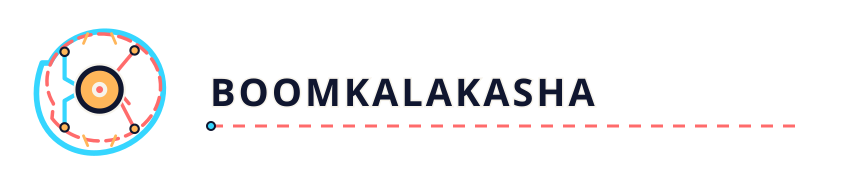
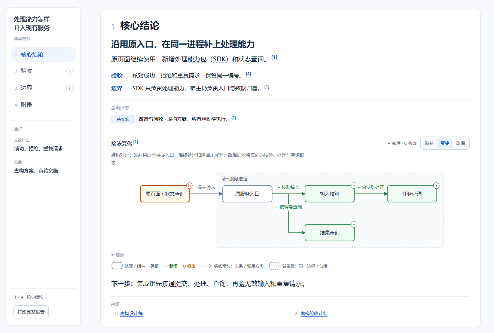

# Evidence HTML Report · 证据型 HTML 报告



[简体中文](README.zh-CN.md) · [Sample report](#what-you-get) · [Quick start](#quick-start) · [Installation](#installation) · [User guide](#user-guide) · [Changelog](CHANGELOG.md) · [Contributing](CONTRIBUTING.md) · [Support](SUPPORT.md) · [Security](SECURITY.md)

> **Give the team the conclusion first. Give every important claim a place to check.**

`evidence-html-report` is a Codex Skill for turning technical assessments, audit reviews, and handoffs into one offline HTML report. Authors work from designs, test records, or other material. Readers only need a browser to see the recommendation, explore each topic, and follow the evidence.

<!-- icarus-release-fact: dynamic -->
Get the package and its checksum file from the [latest GitHub Release](https://github.com/boomkalakasha/evidence-html-report-skill/releases/latest). If your team needs a fixed version, use the ZIP and `SHA256SUMS.txt` from that version in the [release history](https://github.com/boomkalakasha/evidence-html-report-skill/releases).

## At a glance

| If you need to… | The Skill helps you… | You get… |
| --- | --- | --- |
| Review an integration proposal | Lead with the recommendation, then show how the scope, interfaces, and responsibilities change | A technical report with before, changes, and after views ([input example](examples/focus-changes.json)) |
| Review release readiness | Organize individual issues by status, impact, source, and owner | A readiness report with filters and expandable findings ([input example](examples/audit.json)) |
| Hand work to another team | Explain the current state, who owns each step, and how to check the result | A handoff report the receiving team can act on ([input example](examples/reading-layout.json)) |

Use Markdown when a paragraph or small table is enough. This Skill is most useful when some readers only need the conclusion and others will check the details.

## Quick start

To read the result first, [download the interactive HTML sample](https://github.com/boomkalakasha/evidence-html-report-skill/raw/refs/heads/main/examples/focus-changes.html) and open it in a browser. This is an offline file, not a hosted demo.

To generate it yourself, download and extract the release ZIP. From the `evidence-html-report/` directory containing `SKILL.md`, run this command with Python 3. You do not need Codex or extra Python packages for this example.

```text
python scripts/build_report.py --strict examples/focus-changes.json output-focus.html
```

Open `output-focus.html` in a browser. The sidebar lists four sections. On the overview, switch the diagram views and select a numbered citation. If the evidence entry has no external link, the source takes you to the report appendix.

## What you get

[Download the full interactive HTML](https://github.com/boomkalakasha/evidence-html-report-skill/raw/refs/heads/main/examples/focus-changes.html) · [View the editable JSON input](examples/focus-changes.json)



The HTML and screenshot show the same fictional integration proposal, generated with v1.9.0. The sample is in Chinese: use the sidebar to change topics, select the before, changes, or after diagram view, and follow a numbered citation to its appendix entry. The status label means **pending implementation**; the example does not claim implementation or acceptance.

- **For readers:** An offline HTML file containing the text, diagrams, and embedded images. Print the full report from any topic, or read the text in order with JavaScript disabled.
- **For authors:** Keep the input JSON if you want to edit or regenerate the report. Store original material separately and link to it only where readers have access, or give a citation and location instead.

## Installation

1. Download and extract the release ZIP. To check the download, compare the digest in `SHA256SUMS.txt` with `Get-FileHash <archive> -Algorithm SHA256` or `sha256sum <archive>`.
2. Put the complete `evidence-html-report/` directory, including `SKILL.md`, in the Codex skills directory. Use the project's `.agents/skills/` for one project, or `~/.agents/skills/` for your user account. If you already have a working copy under `~/.codex/skills/`, update that copy.
3. Open a new session in a project with access to the report material and select `$evidence-html-report`. The generator needs Python 3. For other hosts, start from [`SKILL.md`](SKILL.md) and verify skill discovery and execution in that host.

Back up the installed directory and any custom files before upgrading. Run the quick start after upgrading. To roll back, restore the backup or install the previous ZIP. To uninstall, remove the installed Skill directory and open a new session. Keep report files and their JSON outside that directory.

## User guide

### Write a report with Codex

Tell Codex **who will read it, what decision they need to make, and what evidence is available**. For example:

> Use $evidence-html-report to turn this design and the local test records into an integration report for reviewers. Start with the recommendation and its biggest limit. Show what changes, then explain who owns the work and how to verify it. Distinguish local tests, pending acceptance, and planned work. Cite important claims and deliver the offline HTML with its input JSON.

Before sharing, follow one important citation to its source or appendix entry. Check for plans described as completed work or local tests presented as formal acceptance. Make sure recipients can access any linked material. If they cannot, state where to find the source and what access is required.

### Generate and update a report from JSON

1. Copy an [example](examples/) and keep it in UTF-8. Use `verdict` for the main conclusion and key limits, and `sections` to organize reader questions.
2. Register the source, location, and limits in `evidence`. If a source has the ID `E1`, write `[[E1]]` beside each claim it supports. A source can be reused across sections.
3. Run the quick-start command with your JSON path and a new HTML filename. `--strict` rejects unrecognized fields. See the [content model](references/content-model.md) and [diagram model](references/diagram-model.md) for tables, diagrams, disclosures, and glossary hints.

### Common questions

- **Why does a source link fail if the report is offline?** The text and embedded images travel with the HTML. External files and websites still require the right network, path, or access. Do not include secrets or material you cannot share.
- **Does a successful build verify the conclusion?** It checks fields, references, and declared diagram outcomes. A reader still needs to verify the facts, the comparability of the diagrams, and what each source can prove.
- **Can I scroll through the whole report or print every section?** The default view switches sections from the outline. Set `readingMode: "continuous"` for continuous scrolling. The full-report print button includes all sections and registered details, regardless of the current section.

## Repository layout and verification

| Path | What it contains |
| --- | --- |
| [`SKILL.md`](SKILL.md), [`references/`](references/) | Writing guidance and the content and diagram models |
| [`examples/`](examples/) | Reproducible fictional inputs and the downloadable HTML sample |
| [`scripts/build_report.py`](scripts/build_report.py), [`assets/`](assets/) | Local generator and offline interface assets |
| [`tests/`](tests/) | Structure, compatibility, and browser checks |

```text
python -m unittest discover -s tests -v
python scripts/build_report.py --self-test
```

For browser checks, install `requirements-dev.txt` and use Chrome or Playwright Chromium. Run `python tests/focus_browser_checks.py --output <directory>` for the default reader and `python tests/browser_checks.py` for the continuous reader. These checks cover generation and interaction, not whether every agent interprets a source the same way.

See [Support](SUPPORT.md) for troubleshooting, [Contributing](CONTRIBUTING.md) for changes, and [Security](SECURITY.md) for vulnerabilities. This project is licensed under [Apache License 2.0](LICENSE).
