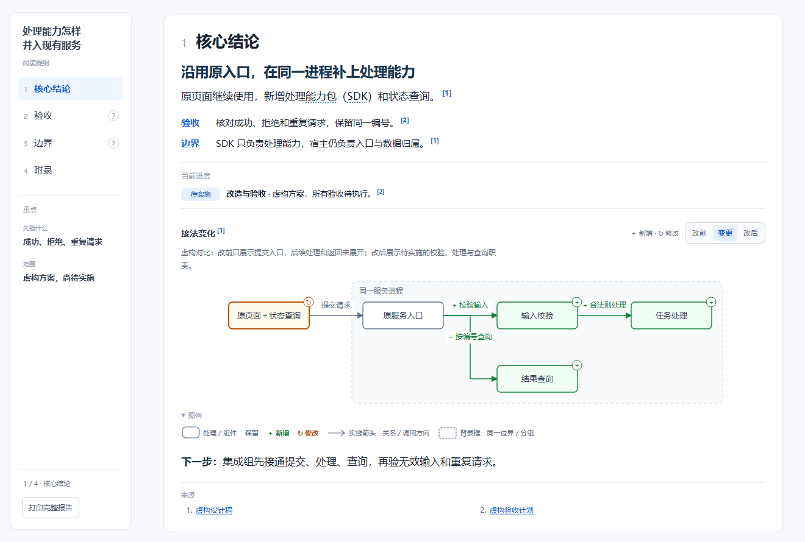

# Evidence HTML Report · 证据型 HTML 报告


[English](README.md) · [示例成品](#你会看到什么) · [快速体验](#快速体验) · [安装](#安装) · [使用手册](#使用手册) · [更新记录](CHANGELOG.md) · [贡献](CONTRIBUTING.md) · [支持](SUPPORT.md) · [安全](SECURITY.md)

> **先让团队看懂结论，需要追问时，每个重要判断都有出处。**

`evidence-html-report` 是一个 Codex Skill，适合把技术评估、审计复盘和团队交接做成一份离线 HTML。作者需要准备设计、测试记录或其他材料；读者只需要浏览器就能看结论、按主题展开详情和核对依据。

<!-- icarus-release-fact: dynamic -->
安装包与校验文件见 [GitHub 最新正式版](https://github.com/boomkalakasha/evidence-html-report-skill/releases/latest)和[发布记录](https://github.com/boomkalakasha/evidence-html-report-skill/releases)。团队要固定版本时，从发布记录下载指定版本的 ZIP 和 `SHA256SUMS.txt`。

## 一览

| 你想做什么 | Skill 怎样帮你 | 你会得到什么 |
| --- | --- | --- |
| 让评审决定一个接入方案 | 先讲推荐做法，再用变化图说明范围、接口和职责 | 能对照改前、变更、改后的方案报告（[输入样例](examples/focus-changes.json)） |
| 复盘一次发布准备 | 按问题整理状态、影响、依据和责任 | 可以筛选并逐项展开的核验报告（[输入样例](examples/audit.json)） |
| 把任务交给另一组人员 | 按主题写清现状、分工、工作顺序和验收 | 接手人能照着做的交接报告（[输入样例](examples/reading-layout.json)） |

一段话或一个小表已经能讲清楚时，直接用 Markdown 就够了。这个 Skill 更适合一部分读者只看结论，另一部分读者需要核对细节的情况。

## 快速体验

想先看成品，可以[下载可交互的 HTML 示例](https://github.com/boomkalakasha/evidence-html-report-skill/raw/refs/heads/main/examples/focus-changes.html)，下载后用浏览器打开。这是离线文件，当前没有托管的在线演示页。

自己生成时，下载正式版 ZIP 并解压。进入含 `SKILL.md` 的 `evidence-html-report/` 目录，用 Python 3 运行下面的命令；这一步无需安装 Codex，也不需要额外的 Python 依赖。

```text
python scripts/build_report.py --strict examples/focus-changes.json output-focus.html
```

用浏览器打开 `output-focus.html`。左栏会显示四个主题；在「核心结论」切换变化图，再点一句判断旁的编号。没有外部原件链接时，来源会指向报告附录。

## 你会看到什么

[下载完整交互 HTML](https://github.com/boomkalakasha/evidence-html-report-skill/raw/refs/heads/main/examples/focus-changes.html) · [查看可编辑的 JSON 输入](examples/focus-changes.json)



HTML 与截图展示的是同一份虚构接入方案，由 v1.9.0 生成器生成。打开成品后，切换左侧主题、对照「改前／变更／改后」，再沿数字角标查到附录中的依据。图中的「待实施」是样例状态，没有暗示改造或验收已完成。

- **给读者：** 一份可离线打开的 HTML。图、主题说明和已内嵌的图片都在文件里。可以打印完整报告；禁用 JavaScript 时正文仍可连续阅读。
- **给作者：** 建议同时保留输入 JSON，方便修订和重生成。原材料可单独归档，报告只保留读者有权限访问的入口或出处说明。

## 安装

1. 下载并解压正式版 ZIP。需要核对下载时，把 `SHA256SUMS.txt` 中的值与 `Get-FileHash <安装包> -Algorithm SHA256` 或 `sha256sum <安装包>` 的结果比较。
2. 把含 `SKILL.md` 的整个 `evidence-html-report/` 放进 Codex 技能目录。只用于一个项目时放到项目的 `.agents/skills/`；供当前用户多个项目使用时放到 `~/.agents/skills/`。在 `~/.codex/skills/` 已有可用安装的用户，更新原目录即可。
3. 在能读取报告材料的项目中打开新会话，输入 `$evidence-html-report` 选择 Skill。生成 HTML 的环境需要能运行 Python 3。其他宿主可参考 [`SKILL.md`](SKILL.md)，需自行验证加载和执行方式。

升级前备份现有目录及自定义文件；升级后用快速体验确认。需回退时恢复备份或安装上一版 ZIP；卸载时移除该 Skill 目录并打开新会话。生成的报告和 JSON 请另存，不要放在待替换的安装目录里。

## 使用手册

### 用 Codex 从材料写报告

先告诉 Codex **给谁看、要判断什么、有哪些材料支持判断**。例如：

> 用 $evidence-html-report，根据这份设计稿和本地测试记录，为评审组做一份接入方案报告。先给推荐做法和最大限制，再用图说明改前与改后，按主题写职责和验收。区分本地已测、尚未验收和待实施，给重要判断附上具体出处。输出离线 HTML，并保留可重生成的 JSON。

打开成品后，挑一个关键判断，沿编号查到原项或附录。再核对是否把待实施写成了已完成，或把局部测试当成正式验收。转发前确认对方能访问所链接的材料；不能分享原件时说明定位和访问限制。

### 从 JSON 生成和更新

1. 复制一个[样例](examples/)，以 UTF-8 保存。用 `verdict` 写总判断和关键限制；用 `sections` 按读者要了解的问题拆主题。
2. 在 `evidence` 登记出处、定位和限制。来源 ID 如果是 `E1`，就在对应判断之后写 `[[E1]]`。同一来源可在多个章节复用。
3. 用快速体验中的命令，把样例路径改成你的 JSON，输出到新的 HTML 文件名。`--strict` 会拒绝未识别的字段。需要图、表格、折叠或下划线释义时，查[内容模型](references/content-model.md)和[图解模型](references/diagram-model.md)。

### 常见问题

- **HTML 能离线打开，为什么原材料链接打不开？** 正文和已内嵌图片在 HTML 内，外部文件和网页不一定在。分享前核对网络、路径和权限，不要把凭据或不能分享的资料写进报告。
- **生成通过，等于结论得到验证吗？** 不等于。生成器可以验证字段、引用和已登记结果节点，仍须有人核对事实、前后图是否可比，以及证据能支持到哪一步。
- **可以连续滚动或完整打印吗？** 默认用目录切换主题；可设 `readingMode: "continuous"` 保留连续阅读。点击「打印完整报告」会打印各主题和已登记的详情，不受当前页限制。

## 项目结构与验证

| 路径 | 用途 |
| --- | --- |
| [`SKILL.md`](SKILL.md)、[`references/`](references/) | 写作规则、内容与图解模型 |
| [`examples/`](examples/) | 可重跑的虚构输入及可下载的 HTML 成品 |
| [`scripts/build_report.py`](scripts/build_report.py)、[`assets/`](assets/) | 本地生成器及离线界面资源 |
| [`tests/`](tests/) | 结构、兼容和浏览器回归 |

```text
python -m unittest discover -s tests -v
python scripts/build_report.py --self-test
```

浏览器回归需安装 `requirements-dev.txt` 中的依赖，并准备 Chrome 或 Playwright Chromium。运行 `python tests/focus_browser_checks.py --output <输出目录>` 检查默认阅读模式，运行 `python tests/browser_checks.py` 检查连续阅读。通过这些测试说明报告生成和交互正常，不证明每个 Agent 对材料的理解相同。

问题排查见[支持](SUPPORT.md)，修改建议见[贡献](CONTRIBUTING.md)，漏洞按[安全说明](SECURITY.md)报告。本项目以 [Apache License 2.0](LICENSE) 发布。
